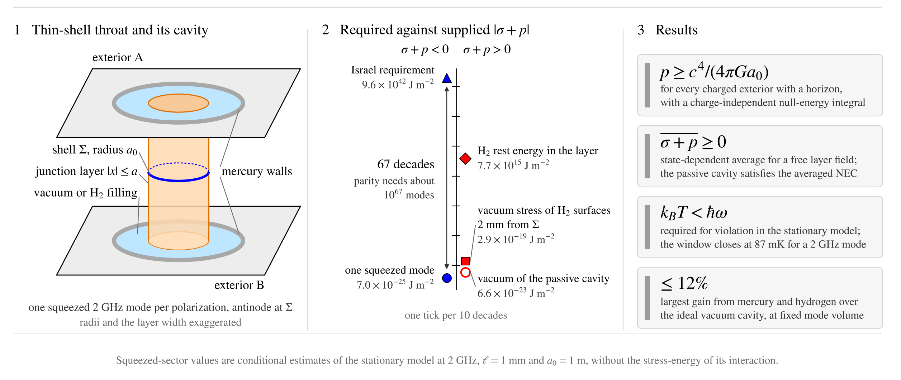

# Squeezed electromagnetic fields at thin-shell wormholes: null-energy bounds for material sources and charged exteriors



Code and data behind every number and figure of the manuscript of the same title (Wahyu Rahmaniar, Institute of Science Tokyo; Bilal Ramzan, University of Agriculture, Faisalabad).

A static thin-shell wormhole joins two exteriors along a two-sphere of areal radius a₀, and the Israel conditions fix the stress that the shell must carry. A half-wave cavity with mercury walls straddles the throat, filled with vacuum or condensed hydrogen, and holds one 2 GHz mode per polarization. The code computes what this source supplies in the junction layer: the squeezed field of a stationary model, the complete Casimir vacuum stress of the planar stack from Lifshitz theory, thermal radiation and the hydrogen rest energy. It also derives the junction conditions for Reissner-Nordström exteriors.

## Main results

- For flat exteriors the Israel conditions require σ + p = −c⁴/(4πGa₀), which is −9.6 × 10⁴² J m⁻² at a₀ = 1 m. Every Reissner-Nordström exterior with a horizon requires p ≥ c⁴/(4πGa₀), and the null-energy integral through the throat, −c⁴/(2πGa₀), does not depend on the charge.
- The period-averaged, state-dependent null combination of a free field in the junction layer is non-negative in every state. The complete vacuum stress of the planar passive cavity is positive, +6.6 × 10⁻²³ J m⁻², so that cavity satisfies the averaged surface null energy condition in every state.
- In the stationary squeezed model, with the stress-energy of its interaction excluded, violation requires k_BT < ħω, a window that closes at 87 mK for a 2 GHz mode.
- The squeezed sector then supplies 5.4 × 10⁻⁶⁸ to 8.4 × 10⁻⁶⁸ of the requirement per mode, about 67 decades short, and mercury and hydrogen raise it by at most 12%.
- Hydrogen surfaces 2 mm from the throat add a positive vacuum stress 5.7 decades larger than the squeezed contribution. Hydrogen inside the layer adds a rest energy 40 decades larger.

## Contents

| Path | Purpose |
| --- | --- |
| `scripts/hg_model.py` | Mercury-hydrogen junction model: wall impedance, stationary Gibbs state, stress decomposition, thermal window and the supplied-to-required ratio of every configuration; writes `model_results.json` |
| `scripts/casimir_layer.py` | Complete renormalized vacuum stress of the planar layered cavities (Lifshitz theory); writes `casimir_results.json` |
| `scripts/rn_thin_shell.py` | Junction conditions, null-energy integral and stability for Reissner-Nordström exteriors, symbolic and numerical; writes `results_rn.json` |
| `scripts/eqcheck.py` | Symbolic, operator and field checks of the manuscript equations |
| `scripts/fig1_configuration.py` | Fig. 1: the junction and the apparatus |
| `scripts/fig2_configurations.py` | Fig. 2: the four configurations and the thermal window |
| `scripts/fig3_feasibility.py` | Fig. 3: feasibility and the complete junction requirement |
| `scripts/figstyle.py` | Shared figure style (STIX fonts, final printed size) |
| `scripts/*.json` | Stored outputs of the three model scripts |
| `assets/` | Graphical abstract |

## Reproduce

Python 3.10 or later (tested with 3.13, NumPy 2.5, SciPy 1.18, Matplotlib 3.11, SymPy 1.14).

```bash
pip install -r requirements.txt
cd scripts
python hg_model.py              # junction model; writes model_results.json
python casimir_layer.py         # Lifshitz vacuum stress; writes casimir_results.json
python rn_thin_shell.py         # charged exteriors, 46 checks; ends with "failures: 0", writes results_rn.json
python eqcheck.py               # 116 equation checks; ends with "0 failures"
python fig1_configuration.py    # manuscript figures go to figures/, which git ignores
python fig2_configurations.py
python fig3_feasibility.py
```

The whole sequence takes under a minute. The figure scripts import the model modules, so they recompute what they plot.

## Scope

Gravity is semiclassical, with the renormalized stress tensor as the source, and the shell has zero thickness and carries the projected stress of the layer. The passive loaded cavity and the stationary interacting source are distinct models. The squeezed-sector values are conditional estimates of the stationary model in a single-mode truncation: its interaction acts within the junction layer, and the stress-energy of that interaction is not evaluated. Hydrogen is treated as a linear lossless dielectric at 2 GHz, and the walls are the only dissipative channel.

## Citation

See `CITATION.cff`. Please cite the manuscript once its reference is available.

## License

MIT, see `LICENSE`.
